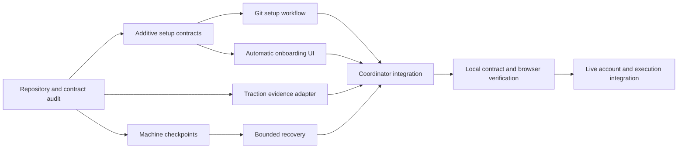

# Self-driving setup and operation

The product direction is autonomous by default. The person connects a repository and grants a bounded operating scope;
Ephyra prepares the application, investigates production evidence, checks its own proposed actions, proves and lands
repairs, watches results and recovers from unsuccessful approaches. Supervised review is an explicit mode. An inbox is
for targeted help and optional oversight, not the normal engine of progress.

## Implemented foundation

- HTTPS smart Git connection and default-branch discovery, independent of GitHub, GitLab, Forgejo or another host.
  Tangled and Radicle need a valid HTTPS clone/gateway endpoint in this onboarding flow; native transport is not implied.
- Durable automatic setup, inspectable stages, real generated documents and capability blockers. Existing policies are
  preserved. A generic generated intent describes what is unknown rather than inventing product requirements.
- Model-evaluated advisory checkpoints, exact identities and thresholds, proof/revision binding, durable receipts and
  bounded reevaluation. Checkpoint questions and results are visible with the trail evidence.
- Read-only Traction evidence using the inspected local service contract, with workspace/project scoping, provenance,
  freshness and partial coverage. A generic server gatherer injects configured sources into research/reproduction.
- Recovery instructions that retain failed attempts, change hypothesis, seek independent evidence and request a targeted
  unblock question when exhausted. Context reset is conditional on the executor actually supporting it.
- Desktop/phone onboarding and exact-operation reconciliation after a lost response.

## What activation must mean

Connecting a repository is not proof that its application is self-driving. Every required capability has an observed
state, a source/receipt and an accountable integration. The setup job currently prepares configuration and checks the
host's capability declarations. It does not claim to have executed a verification baseline or provisioned a runner.
Only ready configuration is installed into the runtime. Missing capabilities are operator work rather than a list of
manual configuration files the end user is expected to author.

The next integration must provision account-bound execution, run the repository's discovered checks in that sandbox,
record baseline failures, derive and validate intent probes, establish telemetry scope and freshness, and verify the
chosen landing/rollback transport. Model credentials and access tokens remain outside the journal. Generated config
must never grant itself more authority, remove required evidence, reset budgets or widen a telemetry project scope.

## Investigation and getting unstuck

A trail should expose its current question, alternatives considered, observations needed, tools used, source coverage,
answers and decisions, actual model identity, cost when known, attempts, next action, and reason for any stop. A useful
recovery changes one of the hypothesis, evidence source, probe, executor context or authorized model. It does not simply
repeat the same failed operation under a new idempotency key. The shipped planner covers alternative hypotheses and
additional evidence; model switching and generic provider-session reset still need explicit adapter capabilities.

People are one information source. An unblock request should specify the missing fact or authority, the person/role
most likely to have it, the evidence already checked, why the answer changes the next action, delivery status and how
an answer will be validated. User research, contact routing and message delivery are follow-on integrations; no messages
were sent during implementation. A response is evidence, never a new capability grant. Paid respondent studies remain
within the previously granted budget and consent scope.

Traction can supply aggregate project context and source coverage. Its current private API is single-operator and is
not a tenant authority; Not Organic and the hosting integration must authorize each project's credential binding.
Direct PostHog error logs, replay, traces and targeted user investigation need separate adapters and end-to-end evidence.
The public Traction health check alone cannot establish that those sources are configured or useful.

## Execution graph and gates

| Work | Ownership | Acceptance |
|---|---|---|
| Contracts, setup, composition | Coordinator: core setup/settings exports, server setup/composition | Additive contracts, actual git refs, no fake readiness, scoped auth |
| Checkpoints and recovery | Worker: server wiring/checkpoints and recovery | Automatic A/B/C, stale/uncertain rejection, bounded attempts |
| Evidence | Worker: evidence Traction adapter and server research gatherer | Exact contract, filtered scope, honest missing data, bounded reads |
| Onboarding | Worker: console client/components/stories and browser scripts | Default automatic start, persisted progress, optional supervision, no duplicate starts |
| Integration and checks | Coordinator | Focused tests, package checks, one full-repository gate, no unrelated edits |

The implementation changes the default experience and supplies working local foundations. Hosted provisioning,
automatic verification execution, native forge onboarding, outbound user investigation and a real production repair
remain separate acceptance gates. The existing high/critical proof constraints are still enforced.
