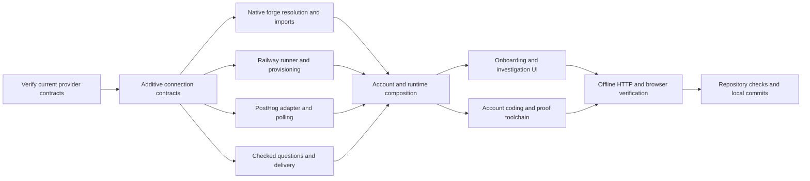

# Self-driving setup and operation

Ephyra is autonomous by default. A person connects a repository, selects the model billed to their account, and can
optionally connect knowledge, telemetry and contacts. The server prepares policy and verification documents, provisions
an isolated runner, investigates observed signals, checks decisions, proves changes and records why work stops.
Supervised checkpoints remain an explicit mode.

## Implemented paths

- Repository onboarding resolves GitHub, GitLab, Forgejo and generic HTTPS Git; native `rad:<RID>` and Radicle browser
  links; and Tangled handles/AT URIs. Canonical identity determines the workspace before fetch. Tangled verifies the
  owner declaration, repository DID and knot; private credentials are bound to the clone host. HTTPS negotiates SHA-1
  or SHA-256. Radicle uses temporary scoped profiles, managed nodes, bounded imports and cleanup receipts.
- Railway hosting has a pinned SDK adapter, actual allocation/exec/files/checkpoint/restore/destroy operations, scoped
  operation receipts, persisted leases and cleanup jobs. A host grants accounts a provider environment once; users
  do not write runner configuration. Missing toolchains and ambiguous allocation/cleanup remain explicit.
- The selected account model runs a bounded coding loop on the control plane. Credentials stay outside the VM.
  Structured sandbox tools and model calls have separate durable receipts. Recorded tool calls/results and patch
  artifacts are visible in runs and git. Code moves through exact-commit bundles, including SHA-256 repositories.
- Automatic setup generates autonomy, thresholds, evidence/recovery configuration and an intent document. Existing
  policy is retained. Sandbox baseline execution records manager/lockfile, actual commands, exits, outputs, timings
  and destruction. An unrun command, missing tool or unknown exit cannot become passing evidence.
- Not Organic knowledge remains an optional onboarding connection. Ephyra uses only the exact shared resources/tools
  selected for this account and workspace. Catalog discovery does not execute tools; revoked access blocks receipt reuse.
- PostHog supplies scoped exception evidence and optional recording metadata/console logs. Durable polling uses fixed
  read-only queries, a timestamp-plus-UUID cursor, overlapping windows and observed event dedupe. Empty data, unknown
  retention, stale results and partial coverage remain visible. Model text cannot change the project or query.
- A stuck investigation can draft one specific factual question and choose a configured contact. A calibrated decision
  checks the question before delivery. The default owner inbox requires no additional setup. Other contacts use an
  authenticated delivery bridge and scoped, expiring answer links. Answers are checked before the same revision resumes.
  The question, chosen recipient, checks, delivery status and answer are inspectable in the trail.
- Recovery retains failed hypotheses, source references, operation receipts and remaining budget. It changes hypotheses,
  gathers new evidence, or starts a fresh supported context. One checked answer permits one additional isolated attempt.
  An ambiguous write, spending cap or permission boundary cannot be bypassed by a question or context reset.

## Activation and evidence boundaries

`SetupRun.investigationActive` separates active investigation from full landing readiness. An agent, isolated runner,
decision backend and observed baseline can activate research while remote landing/watch remain blocked. The personal
landing handler refuses writes without verified remote authority and watch coverage. Missing product intent and
high/critical proof obligations still prevent approval; generated prose is not evidence that a product requirement is true.

The hosting environment needs explicit Railway credentials/environment and account grants. CPU, memory and idle timeout
are configurable; the provider does not enforce a disk quota, which is recorded explicitly. Idle timeout is not an
absolute lifetime guarantee. Persisted lease cleanup and bounded reconciliation run without an open browser. Unknown
creates without a returned provider ID need operator reconciliation and never allocate a replacement blindly.

Convex is required for durable account settings and workflow queues. File-backed external-operation receipts survive
local process restarts, but development memory mode does not preserve queued polling cursors or account settings.
Changing repositories/branches selects a new workspace and clears previous telemetry, knowledge and contact authority.
A bridge response, user answer or source document is data and never grants capabilities.

The bridge is an integration with the operator's messaging system, not an inferred permission to email arbitrary people.
A configured recipient and checked factual question are required. Delivery timeouts are uncertain, not failures to retry.
An authenticated reply may confirm delivery; it still must pass answer checks and match current workspace, roster and code.

## Execution graph and ownership

| Work | Owner | Acceptance |
|---|---|---|
| Contracts, account authority, composition, coding loop, bundles | Coordinator | Scoped credentials, durable operations, no fabricated evidence |
| Native forge resolution/imports and console | Repository/UI worker | Exact identities, SHA-256 fixtures, optional setup, lost-response reconciliation |
| Railway, provisioning and proof preparation | Execution worker | Actual SDK contracts, bounded commands, cleanup, stable receipts, real toolchain checks |
| PostHog, polling, checked contact routing and HTTP isolation tests | Evidence worker | Observed events, scoped authority, bounded paging, checked answers, no ambiguous resend |
| Final integration, documentation, release lock and commits | Coordinator | Focused tests and one repository-wide gate; preserve unrelated work |

## Verification scope

Offline tests substitute provider/network boundaries and exercise real local Git and HTTP application paths. They cover
native metadata, bundle transport, command receipts, exact decision identities, stale/revoked authority, repeated delivery,
unknown outcomes, restart receipts and desktop/phone flows. The official SDK/docs and pinned Radicle release metadata
were read; no live paid allocation, native remote operation, PostHog project query or outbound user message was performed.

Live provider/account access, delivery through a deployed bridge, remote landing/rollback, deployment attribution and
an actual production repair remain acceptance evidence to collect in an authorized deployment. These are not represented
as successful tests or completed repairs by the interface.
