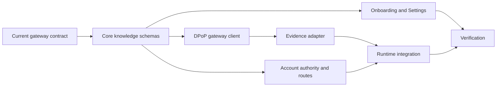

# Account knowledge during setup

Ephyra can use knowledge connections owned by the signed-in Not Organic account. Onboarding offers an optional connection step; Settings keeps the same controls available later. Not Organic owns remote MCP credentials and grants. Ephyra stores only the workspace's selected source IDs, resource permission, and exact research-tool definition hashes.

## Execution graph

| Node | Owner and write set | Gate |
| --- | --- | --- |
| A/B/F/G | Coordinator: core contracts, accounts/application/compose, research wiring | Bound account/workspace; backward-compatible optional fields |
| C | Gateway worker: `apps/server/src/auth/knowledge.ts` and tests | Exact DPoP, bounded transport, no credential leakage or retries |
| D | Console worker: console source, fixtures and tests | Optional setup, explicit selection, stale response guards, existing settings intact |
| E | Evidence worker: `apps/server/src/setup/knowledge-evidence.ts` and tests | Live grants, exact definitions, bounded untrusted evidence, replay safety |
| H | Coordinator: integration/browser checks and documentation | Focused tests, final repo checks, production build and offline browser flow |

## Authority and execution

- Enabling knowledge requests `knowledge:read` and `knowledge:tools` in a fresh Not Organic authorization. Refresh cannot expand a grant. Existing selected model scopes are retained.
- The portal handoff uses the exact public `app_client` and a same-origin `/app/#/onboarding` return link. It is a navigation hint, never permission. The owner grants resources and individual tools in Not Organic.
- Nothing is selected automatically. A workspace can select resource reads and an eligible research tool. Tools must claim read-only behavior, have no destructive hint, and accept one supported, unconstrained string query argument. These annotations are claims; the portal grant and explicit workspace choice authorize use. Ephyra sends a bounded research query, not model-generated arbitrary arguments.
- Tool definitions are hashed in full, including unknown metadata. Permission or definition changes block execution until the owner selects an available definition again. Read results and cached/replayed tool results are checked against current local and upstream authority before release.
- Enabling or disabling access is an idempotent, versioned account mutation. Choices made before the first repository follow that initial setup; choosing another repository or branch clears knowledge access for the new workspace. Old runtimes fail their authorization check.
- Runtime research resolves current source choices on every attempt. Source content stays in escaped untrusted evidence blocks and attributed journal artifacts; it cannot authorize new actions. Knowledge does not count as proof that the bug was reproduced or the patch passed.
- Tool calls claim a stable operation key before dispatch. The key binds the trail/revision/head/query, account, workspace, source and selected definition. Pending or ambiguous outcomes are never retried. Completed results may be reused only after permissions are rechecked. Convex stores production receipts; local installations use private, append-only files with exclusive claims and immutable outcomes. Corrupt or interrupted receipts fail closed.
- Removing Ephyra's local selection stops future reads; the Not Organic portal can also revoke the app's upstream grant. Previously recorded evidence cannot be recalled.

## Verification limits

The tests use the current gateway request/response contract and fictional source content. They cover authorization, exact definitions, revoked access, account/workspace isolation, bounded output, durable replay and onboarding. They make no live provider calls. The deployment must have knowledge enabled and Ephyra's public client registered. Live Not Organic-to-MCP authentication remains unverified here.

Only listed resources and eligible text-query research tools are integrated. Arbitrary MCP actions, resource templates, prompts, binary resources, and other transports are not exposed to autonomous research. Connections and their credentials are created through Not Organic's existing portal.
